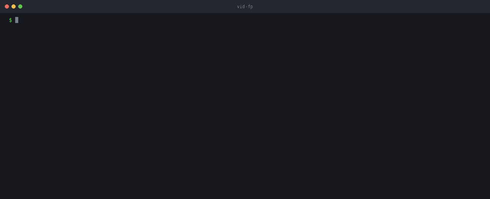

# vid-fp

[](https://github.com/Danielnara24/vid-fp/releases/latest)
[](https://crates.io/crates/vid-fp)
[](https://github.com/Danielnara24/vid-fp/actions/workflows/ci.yml)
[](#license)

**Find duplicate videos from the Linux command line**, including clips cut out
of a longer recording.



`vid-fp` is a duplicate video finder that fingerprints every file from its
keyframes using a perceptual hash. It groups videos that hold the same footage
even when they differ in resolution, bitrate, frame rate, codec or container,
and even when one file is only a section of another. Checksums, file sizes and
filename matching find none of that.

## What it finds

- The same video re-encoded at a different resolution, bitrate or quality
- The same video in a different container: MP4, MKV, AVI, MOV, WebM, TS, etc.
- A trimmed clip, highlight or excerpt sitting inside a longer recording
- A copy mirrored left to right
- A copy with black bars added or removed (letterbox, pillarbox), including bars
  carrying a channel logo or subtitles
- A landscape video re-uploaded as a vertical one, with a blurred or plain fill,
  or cut down to a vertical strip of itself
- A widescreen video cut down to 4:3 (pan and scan, an SD broadcast or VHS copy)
- A copy zoomed in slightly, cropped, or tilted to fill the frame
- A video shown inside another: picture-in-picture, a reaction layout, a screen
  recording of a player
- Copies under different names, in different folders, across several drives

## What it does about it

It reports, and nothing else, until you say otherwise. `--delete` moves the
redundant copies to the system trash, `--move-to` relocates them instead, and
`--permanent` is the only way to erase anything. Reports are written as plain
text, CSV or JSON, and `--from-report` acts on one you have reviewed and edited
by hand.

There is no daemon and nothing running in the background, and the
[desktop app](#desktop-app) is optional. Fingerprints are cached between runs,
so re-scanning a library only decodes the files that changed.

## Requirements

Linux on x86_64 or 64-bit ARM (aarch64), **glibc 2.28 or newer** (Ubuntu
20.04+, Debian 10+, RHEL and its rebuilds 8+, Fedora 29+, current Arch and
Mint, Raspberry Pi OS 64-bit). The release binary bundles FFmpeg 8 and dav1d,
so you do **not** need FFmpeg installed. Any CPU of either kind works; FFmpeg
picks the fastest instructions it has when it starts. The desktop app is
x86_64 only.

## Installation

### Prebuilt binary (recommended)

```bash
curl -L -o vid-fp \
  https://github.com/Danielnara24/vid-fp/releases/latest/download/vid-fp-x86_64-linux-gnu
chmod +x vid-fp
sudo install -m 755 vid-fp /usr/local/bin/vid-fp
```

On 64-bit ARM, download `vid-fp-aarch64-linux-gnu` instead. It is as accurate
as the x86_64 binary but does not always find the same matches, because FFmpeg
shrinks pictures with code written for each kind of processor. A cache shared
between the two keeps their fingerprints apart.

That URL always points at the newest version. Prefer not to use `sudo`? Install
into `~/.local/bin` instead and make sure that directory is on your `PATH`.

Each release also ships a `.sha256` file if you want to verify the download:

```bash
sha256sum -c vid-fp-x86_64-linux-gnu.sha256
```

### From source

Requires the Rust toolchain plus the FFmpeg **development** libraries. FFmpeg 6,
7 and 8 all work:

```bash
# Debian / Ubuntu / Mint
sudo apt install libavcodec-dev libavformat-dev libavutil-dev libswscale-dev \
                 clang pkg-config

# Fedora
sudo dnf install ffmpeg-devel clang pkgconf-pkg-config

# Arch
sudo pacman -S ffmpeg clang pkgconf
```

```bash
cargo install vid-fp --locked
```

This links your system's shared FFmpeg, so the binary is small but tied to that
FFmpeg. Its fingerprints may differ very slightly from the released binary's,
which pins FFmpeg 8, so don't point a source build and a release build at the
same cache expecting agreement.

To reproduce the release exactly instead, self-contained and with AV1 support:

```bash
git clone https://github.com/Danielnara24/vid-fp && cd vid-fp
./scripts/build-ffmpeg-static.sh                  # ~10 min, once
FFMPEG_DIR="$PWD/ffmpeg-static" \
  cargo build --release --features static-ffmpeg  # -> target/release/vid-fp
```

Needs `git make nasm pkg-config python3 python3-venv build-essential`. The
script builds pinned FFmpeg and dav1d releases into `./ffmpeg-static` and is a
no-op on later runs.

### Installing the desktop app: Flatpak

The Flatpak runs on any distribution with Flatpak, Ubuntu 22.04 included.
Download `vid-fp-x86_64.flatpak` from the
[latest release](https://github.com/Danielnara24/vid-fp/releases/latest) and
install it:

```bash
flatpak install --user vid-fp-x86_64.flatpak
flatpak run io.github.danielnara24.vid-fp
```

Flatpak itself is installed on Fedora, Linux Mint and most other desktops
already; on Ubuntu, `sudo apt install flatpak` first, then add Flathub as
[its setup page](https://flathub.org/setup) shows.

The command line comes with it. To start either by its short name, add these
lines to `~/.bashrc` (or your shell's own file):

```bash
alias vid-fp='flatpak run --command=vid-fp io.github.danielnara24.vid-fp'
alias vid-fp-gui='flatpak run io.github.danielnara24.vid-fp'
```

The Flatpak keeps its cache, settings and last scan in
`~/.var/app/io.github.danielnara24.vid-fp/`, apart from those of a `vid-fp`
installed otherwise.

### Installing the desktop app: binary

`vid-fp-gui` needs GTK 4.10 or newer (Ubuntu 23.04+, Debian 13+, Fedora 38+):

```bash
sudo apt install libgtk-4-1
curl -L -o vid-fp-gui \
  https://github.com/Danielnara24/vid-fp/releases/latest/download/vid-fp-gui-x86_64-linux-gnu
chmod +x vid-fp-gui
sudo install -m 755 vid-fp-gui /usr/local/bin/vid-fp-gui
```

From source, add `libgtk-4-dev` to the packages above and build with
`cargo install vid-fp --locked --features gui`. The extras tarball below holds
a desktop entry and an icon.

### Shell completions and man page

Each release ships `vid-fp-<version>-extras.tar.gz` with completions for bash,
zsh, and fish plus a man page:

```bash
tar -xzf vid-fp-*-extras.tar.gz
sudo install -Dm644 completions/vid-fp.bash /usr/share/bash-completion/completions/vid-fp
sudo install -Dm644 completions/_vid-fp     /usr/share/zsh/site-functions/_vid-fp
sudo install -Dm644 completions/vid-fp.fish /usr/share/fish/vendor_completions.d/vid-fp.fish
sudo install -Dm644 man/vid-fp.1            /usr/share/man/man1/vid-fp.1
```

Without `sudo`, into your home directory instead (for zsh, use any directory
already on your `fpath`):

```bash
install -Dm644 completions/vid-fp.bash ~/.local/share/bash-completion/completions/vid-fp
install -Dm644 completions/vid-fp.fish ~/.config/fish/completions/vid-fp.fish
install -Dm644 man/vid-fp.1            ~/.local/share/man/man1/vid-fp.1
```

A source build can generate both itself:

```bash
vid-fp --completions bash | sudo tee /usr/share/bash-completion/completions/vid-fp >/dev/null
vid-fp --man | sudo tee /usr/share/man/man1/vid-fp.1 >/dev/null
```

Open a new shell (bash, fish) or run `compinit` (zsh) to pick them up. Then
`man vid-fp` is the full offline reference, and tab-completion fills in flags,
folder paths, and enum values:

```bash
vid-fp ~/Videos -e ~/Down<TAB>   # completes to a real folder
vid-fp ~/Videos -k <TAB>         # length  resolution  quality  size
```

## Updating

Use the same commands as installing; they overwrite the last version. From
source, re-run `cargo install` with `--force`. Run `vid-fp --version` to compare
against the [latest release](https://github.com/Danielnara24/vid-fp/releases/latest),
and reinstall the completions and man page too.

## Usage

Point it at one or more folders:

```bash
# Report duplicates in a folder and all its subfolders
vid-fp ~/Videos -r

# Scan several folders, excluding one
vid-fp ~/Videos ~/Downloads -e ~/Downloads/keep -r

# Write a report you can open later
vid-fp ~/Videos -r -o results.csv

# Pipe the report to another tool
vid-fp ~/Videos -r -o - --format csv | grep DELETE
```

By default the scan is **not** recursive. Add `-r` to descend into subfolders.
A Trash or recycle bin inside a scanned folder (`.Trash-1000`, `$RECYCLE.BIN`,
a NAS's `#recycle`, the home Trash) is not walked; name it to scan it.

Files are identified by inode, not by path, so a file reachable through a
symlink, a hard link, or two overlapping scan folders is fingerprinted and
reported once. Symlinked *folders* are skipped unless you pass
`--follow-symlinks`.

### Naming files, and reading a list

Individual files can be named alongside folders, and are scanned whatever their
extension:

```bash
vid-fp ~/Videos/episode_a.mkv ~/Videos/episode_b.mp4 ~/Downloads
```

A list of paths can also be read from stdin with `-`, or from a file with
`--from-file`:

```bash
fd -e mkv --changed-within 30d ~/Media | vid-fp -
find ~/Media -type f -size +500M | vid-fp -
vid-fp --from-file suspects.txt -o results.csv
```

Blank lines are ignored and a trailing carriage return is trimmed. For filenames
containing newlines, use NUL separators on both ends:

```bash
find ~/Media -name '*.mkv' -print0 | vid-fp - -0
```

Paths read this way behave exactly as if typed as arguments. Files that aren't
videos are reported under `Problems`, so filter with `fd -e`/`find -name` rather
than piping an entire tree.

### Deleting duplicates

```bash
# Move the files marked DELETE to the trash
vid-fp ~/Videos -r --delete

# Remove them permanently (irreversible)
vid-fp ~/Videos -r --delete --permanent
```

Once the groups are resolved, an armed run stops and asks before touching
anything. Return accepts. Answering `n` doesn't abort the run, it demotes it to
a report-only one, so you still get the full table and the reclaimable figure
without re-scanning. Pass `-y`/`--yes` to skip the prompt.

The prompt only appears when there's a terminal on both stdin and stderr, so it
can never block a script or a cron job.

### Moving instead of deleting

The system trash needs a trash directory on the file's own filesystem, which
external drives, NFS mounts and headless servers frequently lack. Use
`--move-to` in those cases:

```bash
vid-fp /mnt/media -r --move-to /mnt/scratch/dupes
```

This isn't a deletion, so `--move-to` arms the run by itself. If `--delete` or
`--permanent` is passed alongside it, the files are still moved and nothing is
removed.

Each file's **absolute path is recreated inside the destination**:
`/mnt/media/show/ep01.mkv` lands at `/mnt/scratch/dupes/mnt/media/show/ep01.mkv`.
Two files with the same name never collide, you can see where each came from,
and the whole run is undone with a single copy back:

```bash
cp -a /mnt/scratch/dupes/. /
```

Nothing is ever overwritten: an occupied destination slot is reported as a
problem instead. A destination on another filesystem is copied, flushed, and
only then unlinked; if either step fails the original stays where it was.
Timestamps and permissions are preserved.

The destination must sit outside the scanned folders, or the run aborts:
anything moved into a folder being scanned is found again by the next run, which
keeps the moved copy and moves the original in beside it. A folder the scan only
reaches through a symlink counts as scanned, and the refusal names the link. To
put the destination inside the library anyway, exclude it:
`-r --move-to lib/dupes -e lib/dupes`.

### Acting on a report you have reviewed

Save a report, review it, edit it, then hand it back:

```bash
# 1. Look first
vid-fp /mnt/media -r -o dupes.csv

# 2. Edit the action column in dupes.csv, then act on exactly what it says
vid-fp --from-report dupes.csv --delete
```

`--from-report` disposes of every row whose `action` column reads `DELETE` and
touches nothing else. Change `REVIEW`/`KEEP` cells to `DELETE` and they're acted
on; change a `DELETE` to anything else and it isn't. If you mark every copy of
something `DELETE`, every copy is deleted. The confirmation prompt still shows
the count and the byte total first.

Every file is re-checked against the size the report recorded immediately before
it's touched, and left alone if it has changed, so a report can sit for a week
before you get to it. Columns are found by name, so a reordered report still
works, and the format is read from the file rather than its name, so a report
kept as `dupes.bak` replays. Only CSV and JSON reports are accepted; `.txt`
reports refused.

### Checking new files against a library

`--against` asks which scanned files a library already has, instead of grouping
them. The library is scanned and cached like any folder but never compared with
itself and never touched.

```bash
vid-fp ~/Downloads --against ~/Videos -r --list new
```

Each scanned file gets one answer:

| Answer | Meaning | `action` |
| --- | --- | --- |
| `repeat` | A library file it matched ranks level with it or above it | `DELETE` |
| `better` | It outranks every library file it matched | `KEEP` |
| `review` | Matched, but held for the same reasons a scan holds a file for review | `REVIEW` |
| `new` | Nothing in the library matched it | `KEEP`, with no `matched_with` |

So `--delete` and `--move-to` remove repeats only, and the report replays with
`--from-report`. `--list` prints the paths given the answers you name, one a line
(NUL-separated with `-0`), and nothing else goes to stdout. Scanned files are not
compared with each other: two copies of something the library lacks are both
`new`. A file both sides reach belongs to the side whose folder holds it more
closely, so scanning `~/Videos/import` against `~/Videos` answers the import
folder.

## Desktop app

`vid-fp-gui` runs the same scan in a window. Pick folders and options, press
*Scan*, then go through the groups and choose which videos to move to the
Trash. Folders given on its command line are the ones to scan
(`vid-fp-gui ~/Videos`).

- The groups are listed down the left, each shown by a frame of the video the
  scan keeps. A group's videos are listed beside it, each with a thumbnail,
  the figures the terminal listing prints, how much of it matched which file,
  and KEEP, DELETE or REVIEW exactly as the report would say it.
- *Rank by* picks which copy is kept, as `-k` does. Every ranking is worked
  out during the scan, so switching scans nothing again.
- *Compare…* (or C) shows the frames the scan matched between a video and
  its best match, side by side with their times. A chart above draws both
  videos on one time scale with a line per pair: when the pairs agree on
  where one video sits in the other, it is drawn there and the lines run
  straight down; crossing lines are frames that only look alike. The zoom
  button (or Z) narrows it to the matched footage on the same scale, so a
  short clip of a long video fills the width. Click a pair or a line to find it
  in both, double click to see it full size.
- Space, or the check box, marks a video for the Trash. Enter or a double
  click plays it in your video player. *Mark suggested deletions* marks
  exactly the files marked DELETE.
- The menu at the top right, or a right click, shows the file in its folder,
  marks every other video of the group, unmarks, or switches to a tree of
  folders. F1 lists every key.
- The Trash button asks first, and leaves alone any file that changed since the
  scan or whose kept copy has gone or changed. A drive with no Trash is offered
  permanent deletion instead.

The last scan's results and marks are kept, so closing the window loses
nothing.

## Options

| Flag | Description | Default |
| --- | --- | --- |
| `<PATH>...` | Folders and/or video files to scan (required). `-` reads a list of paths from stdin | |
| `--from-file <FILE>` | Read the paths to scan from a file, one per line (`-` = stdin) | |
| `-0`, `--null` | Paths in the list are NUL-separated, for `find -print0` / `fd -0`; also separates `--list` output | off |
| `-r`, `--recursive` | Include subfolders | off |
| `--follow-symlinks` | Descend into symlinked folders. Deletions act on the file the link leads to | off |
| `-e`, `--exclude <PATH>` | Exclude a folder or a single file; repeat for several. Matched by whole path components, so a file must be named exactly, and resolved through symlinks | |
| `-x`, `--extensions <EXT>` | Extensions a **folder walk** treats as videos, comma-separated or repeated. `-x '*'` (quoted) takes every file, including ones with no extension; an entry prefixed with `!` is an exception, so `-x '!flac'` takes every file but those | 18 extensions, listed below |
| `-d`, `--hamming-distance <N>` | Frame-match tolerance, in bits out of 64; higher = less strict matching. Raise to find more duplicates, at the cost of false positives. See [Tuning](#tuning). Values above `32` are refused | `6` |
| `-p`, `--match-percent <F>` | Min % of overlap to count as a duplicate, from `0` to `100`. Lower includes shorter matches, at the cost of false positives. `0` turns the gate off and reports every pair sharing any footage at all; a pair sharing none is never reported | `20.0` |
| `--min-duration <SECS>` | Min shared clip length in seconds for a match. Videos shorter than this are skipped entirely. `0` = off | `0.0` |
| `-k`, `--priority <P>` | Criteria for KEEPING files: `length`, `resolution`, `quality`, or `size`. The chosen one is compared first, the rest follow in the default order. See [Codecs and quality](#codecs-and-quality) | `length` |
| `--keyframe-interval <F>` | Seconds between sampled keyframes (`0` = every keyframe). Higher is faster, but makes short matches harder to find | `0.0` |
| `--min-keyframes <F>` | Min keyframes kept for short videos (only relevant when keyframe-interval > 0; `0` = no floor). Raising it is not monotonic — see [Tuning](#tuning) | `12.0` |
| `-o`, `--output <FILE>` | Optional path to save the report: `.txt`, `.csv`, or `.json`. `-` writes it to stdout | |
| `--format <FORMAT>` | Write the report as `txt`, `csv`, or `json`, whatever `--output` is called | from the extension |
| `--delete` | Move files marked DELETE to the trash | off |
| `--permanent` | With `--delete`, permanently remove instead | off |
| `--move-to <DIR>` | Move the files marked DELETE under `DIR`, recreating their absolute paths inside it. Arms the run on its own and supersedes `--delete`/`--permanent` | |
| `--against <LIBRARY>` | Answer each scanned file against this library (`repeat`, `better`, `review`, `new`) instead of grouping. Repeatable. See [above](#checking-new-files-against-a-library) | |
| `--list <ANSWER>` | With `--against`, print the paths given these answers to stdout, comma-separated (`-0` for NUL) | |
| `--from-report <FILE>` | Act on a `.csv` or `.json` report from an earlier run instead of scanning. Requires `--delete` or `--move-to`. See [above](#acting-on-a-report-you-have-reviewed) | |
| `-y`, `--yes` | Answer yes to the confirmation shown before any file is touched | off |
| `-t`, `--threads <N>` | Worker threads (`0` = uses all cores). Raising it above that does not speed up a local scan and does raise peak memory, but can help when the videos are on a network mount or a slow disk. Capped at four per core, or 16, whichever is larger | `0` |
| `-q`, `--quiet` | Only print errors | off |
| `--log-file <PATH>` | Write every log line to this file, including the failures the terminal never shows. Not affected by `--quiet`. Truncated at the start of each run | |
| `--cache <PATH>` | Use this cache file instead of the default one. Needed to run multiple scans at once, since a run locks its cache for the whole scan | `$XDG_CACHE_HOME/vid-fp/fingerprints.redb` |
| `--clear-cache` | Wipe ALL vid-fp cache before running | off |
| `--prune-cache` | Drop cached entries only for files not in this scan. Skipped when the scan was incomplete | off |
| `--completions <SHELL>` | Print a completion script for `bash`, `zsh`, `fish`, `elvish`, or `powershell` and exit | |
| `--man` | Print the man page (roff) and exit | |

A folder walk treats these 18 extensions as video by default:

`mp4` `m4v` `mkv` `webm` `avi` `mov` `flv` `wmv` `asf` `mpg` `mpeg` `m2ts`
`mts` `ts` `vob` `ogv` `3gp` `divx`

A positive `-x` list replaces that default rather than narrowing it, so `-x mp4`
walks for `.mp4` alone.

## Tuning

The two knobs that decide what counts as a duplicate are `-d` (how different two
frames may be) and `-p` (how much of a video must match). They trade off against
each other, so change one at a time.

`-d` counts differing bits of a 64-bit frame hash. Two unrelated frames sit
about 32 bits apart, so the useful range is roughly 2 to 8: below that only a
near-identical re-encode matches, above it unrelated footage starts to.

**Each frame is hashed twice, and a match has to hold in both.** Besides the
coarse hash, every frame gets a second 64-bit hash of finer detail. Two frames
that only share a layout (two lines of text on black, two road scenes) agree on
the first and not the second; two encodes of one frame agree on both. `-d` is
applied to the two together: it sets how far below chance their combined
distance must be, the same distance below chance as `-d` bits are on one hash.
The combined distance is always even, so two neighbouring values of `-d` can
accept exactly the same matches (`-d 5` and `-d 6` do).

**A frame match is judged on its distance and on whether anything backs it up.**
Two encodes of the same footage place every frame they share at one constant
time offset, so their matches corroborate each other; two videos that merely
look alike produce matches scattered across unrelated moments. A match with
nothing behind it must be within `-d`; one that another frame match agrees with
(a different frame of each video, at the same offset give or take one keyframe
gap) may be somewhat further, and further still needs more agreeing matches. No
two of them may share a frame on either side, or one static shot would supply
them all.

Once two matches agree on an offset, a frame between them only has to be close
to the frames at that offset, not to every frame in the other video, so it may
be one step further again. This is what recovers the middle of a clip whose
keyframes fall between the source's.

All of it moves with every rung of `-d`, so the flag stays a sensitivity
control across its whole range. Raising it finds more, and starts admitting
false positives past about `-d 8`.

**Both knobs are monotone.** Raising `-d` or lowering `-p` only ever *adds*
files to the report; lowering `-d` or raising `-p` only ever *removes* them. The
report at any setting is a subset of the report at every looser one, so start at
the defaults and walk one knob outward until you see something you don't
recognise.

**Not finding duplicates you expect?** Raise `-d`, or lower `-p` if the match is
a short clip inside a long video. Two encodes of the same footage only line up
frame-for-frame when their keyframes do; when they don't, each file samples
moments the other never looked at, and no tolerance can bridge a frame that was
never sampled. Expect a group like that to report well under its full runtime as
shared even though the files are identical end to end.

**Getting false positives?** Lower `-d` first, it's the blunter of the two. Dark
scenes, fades, and letterboxed content look alike to any perceptual hash.
(Frames with no structure at all are dropped rather than hashed, and so are
frames whose picture is a small patch on black, such as a line of lyrics, so
black frames and title cards can't link anything on their own. A video made of
nothing else is reported as having no usable frames.)

`--min-duration` is an absolute floor, in seconds, on how much footage two files
must share. Both gates apply, so `-p 5 --min-duration 60` means "at least 5%
overlap *and* at least a minute of it". It compares against the pair's
conservative shared estimate, the lower of the two files' figures.

It also skips fingerprinting anything shorter than the floor, since such a file
can't contain a long enough shared clip. Videos whose duration the container
doesn't report are never skipped. Changing this flag doesn't invalidate the
cache.

### Sampling fewer frames

`--keyframe-interval` is the speed knob. It sets a minimum gap, in seconds,
between sampled keyframes and drops the rest before they reach the decoder. It
costs recall, since a moment neither file sampled cannot match.

`--min-keyframes` stops that from gutting short videos: when
`duration / --min-keyframes` is finer than the interval, that finer spacing is
used instead, so every video keeps at least that many samples. `0` removes the
floor and leaves the interval to apply at every length. Moving `--min-keyframes`
is nearly free on a library of long videos, and is most of the cost on a library of short clips.

**Raising `--min-keyframes` is not monotone**, unlike `-d` and `-p`. Coverage is
the span each hash stands for, so a denser sample makes every hash stand for
less. Extra samples that match nothing dilute a pair's coverage and can push it
under `-p`, taking the pair out of the report. If you change either flag, check 
that the groups you expect are still there.

## Codecs and quality

These rules decide which copy is kept, not which files match. Matching itself is
codec-blind, so an AV1 encode and an H.264 encode of the same footage land in
the same group.

**`quality` is bits per frame**, bitrate divided by the average frame rate.
Ranking on raw bitrate would prefer whichever copy simply had more frames in it,
since a 60 fps copy needs roughly twice the bitrate of a 30 fps one to look the
same.

**Bits are never compared across codecs.** A modern codec's job is to carry the
same picture in fewer bits, so an AV1 file half the size of an H.264 one is not
"worse". Both `quality` and `size` are only compared between files sharing a
codec; across codecs they tie and the decision falls through to something else.

**A group that spans codecs ends with one survivor per codec.** If the leading
copies match on length and resolution but use different codecs, nothing
comparable remains to rank them, so each codec keeps its own best copy, flagged
REVIEW for you to choose between. The other copies of each codec lost to a file
they *are* comparable with, so they're marked DELETE as usual: five HEVC encodes
and three H.264 encodes of one episode end up as two files to look at, not
eight.

Note that bitrate (and so quality) includes audio, so a copy with lossless 5.1
can outrank one with a better video track and stereo AAC.

Every report shows the codec, frame rate, size, bitrate and quality of each
file.

## Reading the results

**A group is one file and everything that matched it.** That file is listed
first. Every other member was compared with it directly, but not necessarily
with each other, so a group never asserts a comparison the run did not make.
The first file is the one most of the others matched, not the one kept.

**A file can appear in more than one group**, but its action is decided once for
the file, not once per group. A file marked DELETE in one group reads DELETE in
every group it appears in, and a file held for REVIEW anywhere is held
everywhere. So if B is redundant against A and C is redundant against B, both B
and C go in a single pass and A is what's left, rather than needing one re-run
per hop. That's a reason to read a dry run's report before passing `--delete`.

**The matched figure is footage, not frames.** It is how much of *this file's own
runtime* was found in the group member it matched most closely, in seconds, so a
pair linked only by a common title card reads as the second or two that card
lasts. Read it against the file's own length: that ratio is what separates a
re-encode from a shared clip.

Every figure on a row describes that row's file. On a genuine match both ends
agree anyway: a two-minute clip inside a twenty-two minute episode is 100% of
the clip and 9% of the episode, and both rows read two minutes. Where two rows
disagree, one file was found almost entirely inside the other while the other
was barely covered back, which is usually a sampling artifact.

**The `samples` column is how many frame hashes the file's fingerprint holds**,
after featureless frames have been dropped and samples less than half a second
apart have been merged into one (an all-intra file has a keyframe at every frame,
and those extra samples only add chances of a false match). A file with few samples has each one
standing for a long stretch of runtime, so its matched footage comes out coarse.
At the limit, a file with one sample has that sample standing for its entire
runtime, so any match at all covers 100% of it and no `--match-percent` can gate
it. If a row reports far more matched footage than the file on the other end of
the pair, check this column first.

Each row reports the *best* link rather than the worst, since a file only needs
one solid match to be a duplicate. In a group fused by an incidental link (three
episodes sharing an opening sequence, one of which also has a real re-encode of
itself present) the two genuine copies still read as sharing their full runtime.
The flip side is that a high figure says the file matched *something* here
closely, not everything. In a group of three or more, check the pair you care
about.

### CSV and JSON

The console and `.txt` report have one line per file; the machine-readable
formats carry more data:

| Column | Meaning |
| --- | --- |
| `matched_with` | The group member the `matched_seconds` figure on this row describes |
| `identical` | `true` when that member is a byte-identical copy of this file |
| `samples` | How many frame hashes this file's fingerprint holds |
| `matched_from`, `matched_to` | Where that footage sits **in this file's own runtime** |
| `matched_from_seconds`, `matched_to_seconds` | The same two as raw seconds |

The timestamps are per file, not per pair: a two-minute clip cut from the middle
of an episode reads `00:00:00` to `00:02:01` on its own row and `00:19:59` to
`00:22:40` on the episode's, which answers "where in this episode is that clip".

Read the range as an **envelope, not a continuous stretch**: it runs from the
start of the first matching moment to the end of the last, and matches in
between can be scattered. Two episodes sharing an opening and a closing theme
have an envelope covering the whole hour and a `matched_seconds` of about
thirty. When the envelope is much the wider, either the match is scattered or
the file is too coarsely sampled to tell, and `samples` separates those two.

Columns run in three blocks: what the row *is* (`group`, `action`, `full_path`),
what the file *is* (`length` through `quality_bits_per_frame`), and what it was
measured *against* (`matched_with` through `matched_to_seconds`). Anything shown
formatted is followed by the raw number it came from (`length`/`length_seconds`,
`size`/`size_bytes`, and so on), since a spreadsheet cannot sort `1.0MB` against
`900.0KB`. Sort and filter on the raw column, read the other one. Frame rate is
the exception: the reports carry only `framerate_fps`.

Column positions are not stable across versions, and nothing needs them to be.
`--from-report` finds columns by name, so an older or reordered report still
replays.

The JSON additionally gives every file a `matches` array, one entry per group
member it matched, strongest first, each with its own
`matched_seconds` and range. The top-level fields describe entry `[0]`.

### Actions

Every file in a duplicate group is labeled with an action. The label belongs to
the file, not the group: a file in several groups shows the same one in all of
them, resolved as REVIEW > DELETE > KEEP.

- **KEEP**: the best copy in the group, chosen by your `--priority`, and any
  member that ranks above every file it matched. Usually one per group. A
  KEEP is still deleted if it is redundant against something in another group.
- **DELETE**: a copy that lost the ranking to a file it matched, in at least
  one of the groups it appears in.
  Nothing happens to it without `--delete`; the summary totals these into the
  reclaimable figure.
- **REVIEW**: worth a manual look before deleting, for example when the KEEP
  pick is the longest video but a different file has higher resolution, when the
  group holds the best copy of several codecs, or when a file's runtime could
  not be measured at all. REVIEW files are never deleted.

Once armed, DELETE rows report what actually happened: **DELETED** (trashed or
removed), **MOVED** (relocated by `--move-to`), **UNLINKED**, **FAILED**, or
**CHANGED**, meaning the file changed on disk after it was scanned and was left
alone. UNLINKED means the path was one of several names for the same data, a
hard link or a symlink whose other name lies outside the scan: the name is gone,
the bytes are not, and no space was reclaimed.

### Errors

Failures are reported once at the end in the summary: a count per kind and up
to 10 examples of each. `--log-file <PATH>` records every one in full for
grepping.

### Cache

Fingerprints are cached (under `$XDG_CACHE_HOME/vid-fp`, falling back to
`~/.cache/vid-fp`), so re-scanning the same library is near-instant. Use
`--clear-cache` or `--prune-cache` to manage it.

A run takes an exclusive lock on its cache and holds it for the whole scan, not
just while it reads it, so **two runs cannot share one cache**. To scan two
libraries at the same time, give each run its own:

```bash
vid-fp -r ~/Videos/film &
vid-fp -r ~/Videos/tv --cache ~/.cache/vid-fp/tv.redb
```

`--from-report` is the exception: it doesn't read the cache, so it runs anyway
and only reports the entries it couldn't drop.

An entry is invalidated by the file changing (size or modification time) and by
the two flags that decide which frames get sampled, `--keyframe-interval` and,
while an interval is in force, `--min-keyframes`. The comparison flags (`-d`,
`-p`, `--min-duration`) are applied to cached fingerprints and never invalidate
them, so re-running a scan at a different tolerance is instant.

The cache also remembers what each file holds, as a hash of its length and three
64 KB stretches of it. A file that was moved, renamed, touched or restored from
a backup is recognised by that hash and keeps its fingerprint instead of being
decoded again. Files whose length and hash agree are then read whole: those that
are byte-identical are decoded once between them, and the report marks the link
`identical`.

### Files that are not video

`-x '*'`, any `-x '!...'` list, and a path you name outright all hand the file
to FFmpeg, which opens far more than video. Whatever it can render is
fingerprinted and can group with anything else: an image as a single frame, a
track's cover art as a frame carrying the track's length, a text file as an ANSI
terminal picture. Resolution, fps and duration on those rows are FFmpeg's
defaults for the format, not properties of the file.

Neither gate reliably helps. A one-frame file reads as 0% or 100% covered, so
`-p` cannot touch it, and only some of these carry a runtime `--min-duration`
can catch. Drop the kind instead, with `-x '!flac'` or `-x '!flac,!jpg'`, which
still reaches files with no extension.

## Exit codes

| Code | Meaning |
| --- | --- |
| `0` | Ran clean |
| `1` | Fatal error; the run did not complete |
| `2` | Completed, but something failed (see the `Problems` summary) |
| `130` | Interrupted with Ctrl-C |

## Safety

- **Report-only by default.** Without `--delete`, nothing is ever removed.
- **You see the cost before you pay it.** A dry run prints how much the DELETE
  files would reclaim, computed from exactly the set `--delete` would act on.
- **It asks first.** An armed run stops after the groups are resolved and shows
  how many files, how many bytes, and the first ten by name. Return accepts, `n`
  turns the run into a report. The prompt is interactive-only and `--yes` skips
  it, so nothing can hang unattended.
- **Trash, not permanent.** `--delete` moves files to the system trash via the
  FreeDesktop.org spec, so they're recoverable, unless you add `--permanent`.
- **`--move-to` where the trash isn't.** Moving files under a folder of your
  choosing is recoverable in the same way and always available.
- **Do a dry run first.** Look at the output (or a saved `--output` report)
  before running with `--delete`.
- **DELETE always rests on a measurement.** A file is marked DELETE only when it
  lost the ranking to a copy it was directly measured against.
- **No double-counting.** Hard links and symlinks to the same file collapse into
  a single entry, so no set of bytes is fingerprinted or counted twice. That
  entry keeps a real name rather than a symlink, whatever order the scan met
  them in.
- **"Freed" means freed.** A file whose data has another name outside the scan
  is removed like any other, but nothing is reclaimed by it. Those bytes stay
  out of the total and the row is marked UNLINKED.
- **Tab-complete your `-e` paths.** An exclude path that can't be resolved
  excludes nothing.
- **`-e` protects the file, not the spelling.** An excluded file stays excluded
  when the scan reaches it by another route, such as a symlink.
- **Nothing is acted on twice, or blind.** Every target is re-checked against
  its recorded size immediately before it's touched, and a file that changed
  since the scan is left alone and reported.
- **Mixed codecs are never guessed at.** When the only thing separating two
  copies is which encoder made them, both are flagged REVIEW.
- **`--from-report` hands the judgement to you.** The rules above are applied by
  the run that *writes* a report. Replaying an edited one keeps the confirmation
  prompt and the size check, but nothing else: the edited file is the decision,
  and it is not checked for leaving a survivor in each group. A row it cannot
  understand is never guessed at; the file is left alone and the run exits `2`.

## License

Licensed under either of [MIT](LICENSE-MIT) or [Apache-2.0](LICENSE-APACHE) at
your option.

The **released binary** additionally contains FFmpeg (LGPL 2.1+) and dav1d
(BSD-2-Clause), statically linked. That does not affect the licence above, but
because the FFmpeg link is static, LGPL 2.1 §6 entitles you to relink the
program against your own build of FFmpeg. Every release therefore ships
`vid-fp-<version>-ffmpeg-static-libs.tar.gz` (and
`vid-fp-<version>-aarch64-ffmpeg-static-libs.tar.gz` for ARM) with the archives, headers, build
script and instructions needed to do that. The FFmpeg in it is configured
`--disable-gpl --disable-nonfree`, so it is LGPL only.

A `cargo install` build links your system's shared FFmpeg and none of this
applies to it. See [THIRD-PARTY-LICENSES.md](THIRD-PARTY-LICENSES.md).
