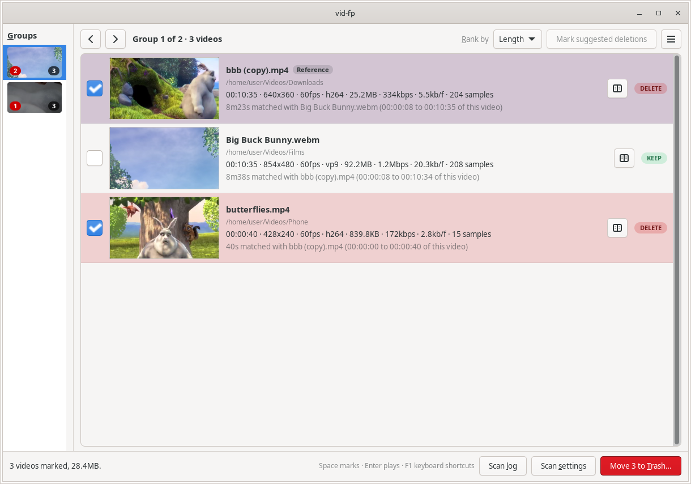
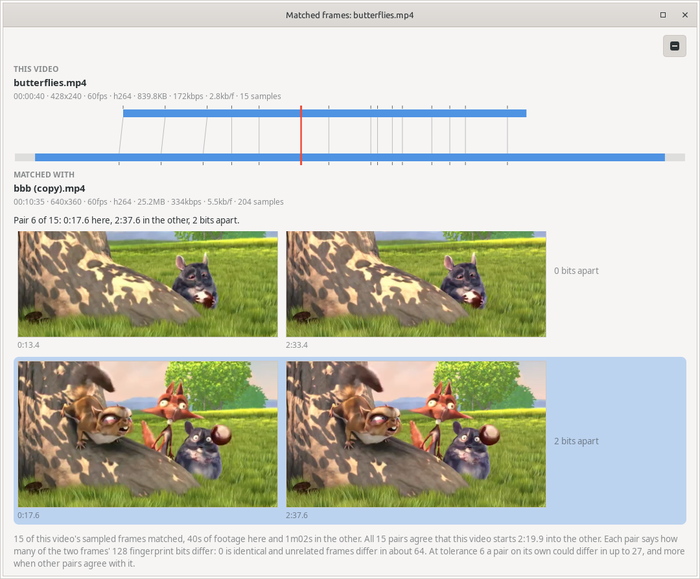

# vid-fp

[](https://github.com/Danielnara24/vid-fp/releases/latest)
[](https://crates.io/crates/vid-fp)
[](https://github.com/Danielnara24/vid-fp/actions/workflows/ci.yml)
[](#license)

**Find duplicate videos on Linux, from the command line or a desktop app**,
including clips cut out of a longer recording.



```text
$ vid-fp ~/Videos -r
...
group_1:
	DELETE,   00:10:35, 640x360, 60fps, h264, 25.2MB, 334kbps, 5.5kb/f, 204 samples, 8m23s matched, /home/user/Videos/Downloads/bbb (copy).mp4
	KEEP,     00:10:35, 854x480, 60fps, vp9, 92.2MB, 1.2Mbps, 20.3kb/f, 208 samples, 8m38s matched, /home/user/Videos/Films/Big Buck Bunny.webm
	DELETE,   00:00:40, 428x240, 60fps, h264, 839.8KB, 172kbps, 2.8kb/f, 15 samples, 40s matched, /home/user/Videos/Phone/butterflies.mp4
...
```

`vid-fp` fingerprints every file from its keyframes using a perceptual hash. It
groups videos that hold the same footage even when they differ in resolution,
bitrate, frame rate, codec or container, and even when one file is only a
section of another. Checksums, file sizes and filename matching find none of
that.

## What it finds

- The same video re-encoded at a different resolution, bitrate or quality
- The same video in a different container: MP4, MKV, AVI, MOV, WebM, TS, etc.
- A trimmed clip, highlight or excerpt sitting inside a longer recording
- A copy mirrored left to right
- A phone video that only carries a rotation flag, matched against a copy with
  the rotation applied
- A copy with black bars added or removed (letterbox, pillarbox), including bars
  carrying a channel logo or subtitles
- A landscape video re-uploaded as a vertical one, with a blurred or plain fill,
  or cut down to a vertical strip of itself
- A widescreen video cut down to 4:3 (pan and scan, an SD broadcast or VHS copy)
- A copy zoomed in slightly, cropped, or tilted to fill the frame
- A video shown inside another: picture-in-picture, a reaction layout, a screen
  recording of a player
- Copies under different names, in different folders, across several drives

## What it does about it

It reports, and nothing else, until you say otherwise. `--delete` moves the
redundant copies to the system trash, `--move-to` relocates them instead, and
`--permanent` is the only way to erase anything. Reports are written as plain
text, CSV or JSON, and `--from-report` acts on one you have reviewed and edited
by hand.

There is no daemon and nothing running in the background. Fingerprints are
cached between runs, so re-scanning a library only decodes the files that
changed.

## Installation

Linux on x86_64 or 64-bit ARM, **glibc 2.28 or newer** (Ubuntu 20.04+, Debian
10+, RHEL 8+, Fedora 29+, current Arch and Mint, Raspberry Pi OS 64-bit). The
release binaries bundle FFmpeg 8 and dav1d, so you do **not** need FFmpeg
installed. The desktop app is x86_64 only.

### Desktop app (Flatpak)

Download `vid-fp-x86_64.flatpak` from the
[latest release](https://github.com/Danielnara24/vid-fp/releases/latest) and
install it:

```bash
flatpak install --user vid-fp-x86_64.flatpak
flatpak run io.github.danielnara24.vid-fp
```

On Ubuntu, `sudo apt install flatpak` first and add Flathub as
[its setup page](https://flathub.org/setup) shows. The command line comes with
it; to start either by its short name, add to `~/.bashrc`:

```bash
alias vid-fp='flatpak run --command=vid-fp io.github.danielnara24.vid-fp'
alias vid-fp-gui='flatpak run io.github.danielnara24.vid-fp'
```

The Flatpak keeps its cache and settings in
`~/.var/app/io.github.danielnara24.vid-fp/`, apart from any other install.

### Command line (prebuilt binary)

```bash
curl -L -o vid-fp \
  https://github.com/Danielnara24/vid-fp/releases/latest/download/vid-fp-x86_64-linux-gnu
chmod +x vid-fp
sudo install -m 755 vid-fp /usr/local/bin/vid-fp
```

On 64-bit ARM, download `vid-fp-aarch64-linux-gnu` instead; it can find slightly
different matches than x86_64, and a cache shared between the two keeps them
apart. Without `sudo`, install into `~/.local/bin`. Each release also ships a
`.sha256` file (`sha256sum -c vid-fp-x86_64-linux-gnu.sha256`).

To update, run the same commands again (`cargo install --force` from source).

<details>
<summary>Desktop app as a plain binary</summary>

`vid-fp-gui` needs GTK 4.10 or newer (Ubuntu 23.04+, Debian 13+, Fedora 38+):

```bash
sudo apt install libgtk-4-1
curl -L -o vid-fp-gui \
  https://github.com/Danielnara24/vid-fp/releases/latest/download/vid-fp-gui-x86_64-linux-gnu
chmod +x vid-fp-gui
sudo install -m 755 vid-fp-gui /usr/local/bin/vid-fp-gui
```

The extras tarball below holds a desktop entry and an icon.

</details>

<details>
<summary>From source</summary>

Requires Rust and the FFmpeg **development** libraries (FFmpeg 6, 7 or 8):

```bash
# Debian / Ubuntu / Mint
sudo apt install libavcodec-dev libavformat-dev libavutil-dev libswscale-dev \
                 clang pkg-config
# Fedora
sudo dnf install ffmpeg-devel clang pkgconf-pkg-config
# Arch
sudo pacman -S ffmpeg clang pkgconf

cargo install vid-fp --locked                 # command line
cargo install vid-fp --locked --features gui  # and the window (add libgtk-4-dev)
```

This links your system's FFmpeg, whose fingerprints can differ very slightly
from the release's, so don't share a cache between the two.

</details>

<details>
<summary>Shell completions and man page</summary>

Each release ships `vid-fp-<version>-extras.tar.gz`:

```bash
tar -xzf vid-fp-*-extras.tar.gz
sudo install -Dm644 completions/vid-fp.bash /usr/share/bash-completion/completions/vid-fp
sudo install -Dm644 completions/_vid-fp     /usr/share/zsh/site-functions/_vid-fp
sudo install -Dm644 completions/vid-fp.fish /usr/share/fish/vendor_completions.d/vid-fp.fish
sudo install -Dm644 man/vid-fp.1            /usr/share/man/man1/vid-fp.1
```

Without `sudo`, use `~/.local/share/bash-completion/completions/`,
`~/.config/fish/completions/` and `~/.local/share/man/man1/`. A source build
generates both itself with `vid-fp --completions bash` and `vid-fp --man`.

</details>

## Desktop app

`vid-fp-gui` runs the same scan in a window. Pick folders and options, press
*Scan*, then go through the groups and choose which videos to move to the
Trash. Folders named on its command line are the ones to scan
(`vid-fp-gui ~/Videos`).



- Each group lists its videos with a thumbnail, their figures, what they matched
  and KEEP, DELETE or REVIEW as the report would say. *Rank by* switches the
  ranking without scanning again.
- The compare button beside each video (or C) shows the frames the scan matched
  between it and its best match, side by side, on one timeline. When the pairs agree on where one video sits in the other the
  lines run straight down; crossing lines are frames that only look alike.
- *Mark suggested deletions* marks the DELETE files, and the Trash button asks
  before moving anything. F1 lists every key.

The last scan's results and marks are kept, so closing the window loses
nothing.

Screenshots show *Big Buck Bunny* (© Blender Foundation, CC BY 3.0).

## Usage

```bash
# Report duplicates in a folder and all its subfolders
vid-fp ~/Videos -r

# Scan several folders, excluding one
vid-fp ~/Videos ~/Downloads -e ~/Downloads/keep -r

# Write a report you can open later
vid-fp ~/Videos -r -o results.csv

# Pipe the report to another tool
vid-fp ~/Videos -r -o - --format csv | grep DELETE
```

The scan is **not** recursive unless you add `-r`. A Trash or recycle bin inside
a scanned folder is not walked; name it to scan it. A file reached through
symlinks, hard links or overlapping folders is scanned once.

### Naming files, and reading a list

Files named alongside folders are scanned whatever their extension. A list of
paths can be read from stdin with `-`, or from a file with `--from-file`:

```bash
vid-fp ~/Videos/episode_a.mkv ~/Videos/episode_b.mp4 ~/Downloads
fd -e mkv --changed-within 30d ~/Media | vid-fp -
find ~/Media -name '*.mkv' -print0 | vid-fp - -0   # filenames with newlines
vid-fp --from-file suspects.txt -o results.csv
```

Files that aren't videos are reported as problems, so filter the list rather
than piping a whole tree.

### Deleting duplicates

```bash
# Move the files marked DELETE to the trash
vid-fp ~/Videos -r --delete

# Remove them permanently (irreversible)
vid-fp ~/Videos -r --delete --permanent
```

The run asks before touching anything (see [Safety](#safety)). Answering `n`
turns it into a report, so you don't have to scan again.

### Moving instead of deleting

Where there is no trash (external drives, NFS mounts, headless servers), move
the files somewhere instead. `--move-to` arms the run on its own:

```bash
vid-fp /mnt/media -r --move-to /mnt/scratch/dupes
```

Each file's absolute path is recreated inside the destination, so
`/mnt/media/show/ep01.mkv` lands at `/mnt/scratch/dupes/mnt/media/show/ep01.mkv`
and the whole run is undone with `cp -a /mnt/scratch/dupes/. /`. Nothing is
overwritten, and timestamps and permissions are kept.

The destination must be outside the scanned folders, or the next run would find
the moved files again. To put it inside anyway, exclude it:
`-r --move-to lib/dupes -e lib/dupes`.

### Acting on a report you have reviewed

```bash
# 1. Look first
vid-fp /mnt/media -r -o dupes.csv

# 2. Edit the action column in dupes.csv, then act on exactly what it says
vid-fp --from-report dupes.csv --delete
```

`--from-report` disposes of every row whose `action` reads `DELETE` and touches
nothing else. Change `REVIEW` or `KEEP` to `DELETE` to act on a row, or change a
`DELETE` to spare one. Columns are found by name, and a CSV re-saved by a
spreadsheet with `,` or tab separators still works. CSV and JSON reports are
accepted; `.txt` reports record no sizes and are refused.

### Checking new files against a library

`--against` asks which scanned files a library already has, instead of grouping
them. The library is scanned and cached like any folder but never compared with
itself and never touched.

```bash
vid-fp ~/Downloads --against ~/Videos -r --list new
```

| Answer | Meaning | `action` |
| --- | --- | --- |
| `repeat` | A library file it matched ranks level with it or above it | `DELETE` |
| `better` | It outranks every library file it matched | `KEEP` |
| `review` | Matched, but held for the same reasons a scan holds a file for review | `REVIEW` |
| `new` | Nothing in the library matched it | `KEEP` |

So `--delete` and `--move-to` remove repeats only. `--list` prints the paths
with the answers you name, one a line, and nothing else goes to stdout. Scanned
files are not compared with each other: two copies of something the library
lacks are both `new`.

## Options

One line each; `vid-fp --help` and `man vid-fp` have the details.

| Flag | Description | Default |
| --- | --- | --- |
| `<PATH>...` | Folders and/or video files to scan. `-` reads a list of paths from stdin | |
| `--from-file <FILE>` | Read the paths to scan from a file, one per line | |
| `-0`, `--null` | Paths in the list (and `--list` output) are NUL-separated | off |
| `-r`, `--recursive` | Include subfolders | off |
| `--follow-symlinks` | Descend into symlinked folders | off |
| `-e`, `--exclude <PATH>` | Exclude a folder or a single file; repeatable | |
| `-x`, `--extensions <EXT>` | Extensions a folder walk treats as video. `-x '*'` takes every file; `-x '!flac'` takes every file but those | 38, listed below |
| `-d`, `--hamming-distance <N>` | Frame-match tolerance; higher finds more. See [Tuning](#tuning) | `6` |
| `-p`, `--match-percent <F>` | Min % of a video that must match, `0` to `100` | `20` |
| `--min-duration <SECS>` | Min shared footage in seconds; shorter videos are skipped | `0` (off) |
| `-k`, `--priority <P>` | What decides the KEEP: `length`, `resolution`, `quality` or `size` | `length` |
| `--keyframe-interval <F>` | Seconds between sampled keyframes; higher is faster. `0` = every keyframe | `0` |
| `--min-keyframes <F>` | Min samples kept per video when an interval is set | `64` |
| `-o`, `--output <FILE>` | Save the report (`.txt`, `.csv`, `.json`); `-` writes it to stdout | |
| `--format <FORMAT>` | Report format, whatever `--output` is called | from the extension |
| `--delete` | Move files marked DELETE to the trash | off |
| `--permanent` | With `--delete`, remove them for good | off |
| `--move-to <DIR>` | Move files marked DELETE under `DIR` | |
| `--against <LIBRARY>` | Answer each scanned file against this library instead of grouping | |
| `--list <ANSWER>` | With `--against`, print the paths with these answers | |
| `--from-report <FILE>` | Act on a CSV or JSON report instead of scanning | |
| `-y`, `--yes` | Skip the confirmation | off |
| `-t`, `--threads <N>` | Worker threads; `0` = all cores. More only helps on slow or network storage | `0` |
| `-q`, `--quiet` | Only print errors | off |
| `--log-file <PATH>` | Write every log line to this file, whatever `--quiet` says | |
| `--cache <PATH>` | Use this cache file | `~/.cache/vid-fp/fingerprints.redb` |
| `--clear-cache` | Empty the cache before running | off |
| `--prune-cache` | Drop cache entries for files not in this scan | off |
| `--completions <SHELL>` | Print a shell completion script and exit | |
| `--man` | Print the man page and exit | |

A folder walk treats these extensions as video by default:

`mp4` `m4v` `mkv` `webm` `avi` `mov` `flv` `wmv` `asf` `mpg` `mpeg` `m2ts`
`mts` `ts` `vob` `ogv` `3gp` `divx` `mxf` `m2t` `mod` `tod` `dv` `m2v` `f4v`
`rm` `rmvb` `ogm` `trp` `tp` `wtv` `3g2` `qt` `mk3d` `vro` `lrv` `mpe` `m1v`

A positive `-x` list replaces that default, so `-x mp4` walks for `.mp4` alone.

## Tuning

Two knobs decide what counts as a duplicate: `-d` (how different two frames may
be) and `-p` (how much of a video must match). Change one at a time.

`-d` is a tolerance in bits of a 64-bit frame hash. Two unrelated frames sit
about 32 bits apart, so the useful range is roughly 2 to 8, and values above 32
are refused. A frame match that other matches agree with, at the same time
offset, may sit a little further apart than one on its own. Neighbouring values
can give identical results (`-d 5` and `-d 6` do).

**Both knobs are monotone.** Raising `-d` or lowering `-p` only ever adds files
to the report, so start at the defaults and move one knob outward until you see
something you don't recognise.

**Not finding duplicates you expect?** Raise `-d`, or lower `-p` if the match is
a short clip inside a long video. Two encodes whose keyframes fall at different
moments can report well under their full runtime as matched even when they are
identical end to end.

**Getting false positives?** Lower `-d` first. Dark scenes, fades and
letterboxed content look alike to any perceptual hash. Featureless frames
(black, title cards, a line of lyrics on black) are never matched, and a video
made of nothing else is reported as having no usable frames.

`--min-duration` is a floor, in seconds, on how much footage two files must
share, on top of `-p`: `-p 5 --min-duration 60` means at least 5% and at least
a minute. Videos shorter than it are not fingerprinted.

### Sampling fewer frames

`--keyframe-interval` is the speed knob: it sets a minimum gap, in seconds,
between sampled keyframes. It costs matches, since a moment neither file sampled
cannot match. `--min-keyframes` keeps short videos from losing out: every video
keeps at least that many samples, so the interval only reaches videos longer
than interval × `--min-keyframes` seconds (32 minutes at an interval of 30).
Past an interval of about 30 the scan barely gets faster.

Unlike `-d` and `-p`, these are not strictly monotone: denser sampling can
dilute a pair's coverage under `-p`. If you change them, check that the groups
you expect are still there.

## Which copy is kept

Matching is codec-blind; these rules only decide which copy of a group is kept.
`-k` picks the property compared first, and the rest follow in the order
`length`, `resolution`, `quality`, `size`.

- **`resolution` counts the picture, not the bars.** A letterboxed copy ties
  with the same film stored without them.
- **`quality` is bits per frame**, bitrate divided by frame rate, so a 60 fps
  copy is not preferred just for having more frames.
- **Bits are compared only within a codec.** An AV1 file half the size of an
  H.264 one is not worse, so `quality` and `size` tie across codecs. A group
  that spans codecs keeps the best copy of each, flagged REVIEW.
- **Quality and size count the video stream** where the container states its
  size (MP4, MOV, AVI, mkvmerge's Matroska), so audio tracks and cover art don't
  count as picture.

Every file in a group gets an action, decided once per file even when it is in
several groups (REVIEW > DELETE > KEEP):

- **KEEP**: the best copy, and any member that ranks above every file it
  matched.
- **DELETE**: lost the ranking to a file it matched. Nothing happens to it
  without `--delete`.
- **REVIEW**: worth a look first, for example when the KEEP is the longest copy
  but another has higher resolution, when copies differ only by codec, or when
  a runtime could not be measured. Never deleted.

Because the action belongs to the file, deletions chain: if B loses to A and C
loses to B, one run removes both. Read a dry run's report before `--delete`.

Once armed, DELETE rows report what happened: **DELETED**, **MOVED**,
**UNLINKED** (the path was a link and the data is still elsewhere), **FAILED**,
or **CHANGED** (the file changed since the scan and was left alone).

## Reading the results

**A group is one file and everything that matched it.** That file is listed
first. Every other member was compared with it directly, not necessarily with
each other. A file can appear in more than one group.

**The matched figure is footage, not frames**: how much of this file's own
runtime was found in the member it matched best. Read it against the file's
length. A two-minute clip of a twenty-two minute episode reads two minutes on
both rows, 100% of the clip and 9% of the episode.

**`samples` is how many frame hashes the file holds.** With few samples each
one stands for a long stretch, so the matched figure is coarse; a file with one
sample reads as 0% or 100% matched and no `-p` can gate it.

### CSV and JSON

The CSV separates fields with `;` (`pandas.read_csv(f, sep=";")`). Beyond the
console's figures it carries:

| Column | Meaning |
| --- | --- |
| `matched_with` | The group member the `matched_seconds` figure on this row describes |
| `identical` | `true` when that member is a byte-identical copy of this file |
| `samples` | How many frame hashes this file's fingerprint holds |
| `matched_from`, `matched_to` | Where that footage sits in this file's own runtime |
| `matched_from_seconds`, `matched_to_seconds` | The same two as raw seconds |

The range runs from the first matching moment to the last, and the matches in
between can be scattered: two episodes sharing an opening and closing theme
span the whole hour with about thirty seconds matched. Formatted columns are
followed by their raw number (`size`/`size_bytes`) for sorting. Column order
can change between versions; read columns by name.

The JSON also gives every file a `matches` array, one entry per member it
matched, strongest first.

### Cache

Fingerprints are cached under `$XDG_CACHE_HOME/vid-fp` (or `~/.cache/vid-fp`),
so re-scanning a library is near-instant, and a moved or renamed file keeps its
fingerprint. An entry is invalidated when the file changes or when
`--keyframe-interval` or `--min-keyframes` change; `-d`, `-p` and
`--min-duration` never invalidate it, so re-running at another tolerance is
instant.

A run locks its cache for the whole scan, so two runs at once need a cache each:

```bash
vid-fp -r ~/Videos/film &
vid-fp -r ~/Videos/tv --cache ~/.cache/vid-fp/tv.redb
```

### Files that are not video

`-x '*'`, any `-x '!...'` list, and a path you name all hand the file to FFmpeg,
which opens far more than video: an image as a single frame, a track's cover art
as a frame carrying the track's length. Those can group with anything. Drop the
kind instead, with `-x '!flac,!jpg'`.

## Exit codes

| Code | Meaning |
| --- | --- |
| `0` | Ran clean |
| `1` | Fatal error; the run did not complete |
| `2` | Completed, but something failed (see the `Problems` summary) |
| `130` | Interrupted with Ctrl-C |

Failures are listed once at the end, up to 10 examples of each kind.
`--log-file` records every one.

## Safety

- **Report-only by default.** Without `--delete` or `--move-to`, nothing is
  touched. A dry run prints how much the DELETE files would reclaim.
- **It asks first.** An armed run shows how many files, how many bytes and the
  first ten by name. Return accepts, except before `--permanent`, which needs a
  typed `y`. The prompt only appears on a terminal, so it never blocks a script;
  `--yes` skips it.
- **Recoverable unless you say otherwise.** `--delete` uses the system trash and
  `--move-to` a folder you choose. Only `--permanent` erases.
- **DELETE always rests on a measurement.** A file is marked DELETE only when it
  lost to a copy it was directly compared with. Copies that differ only by codec
  are held for REVIEW.
- **Nothing is acted on blind.** Every file is re-checked against its recorded
  size (and, in a scan, its change time) right before it is touched, and left
  alone if it changed. So is a file whose every better copy has gone or changed
  since.
- **No double-counting.** Links to the same data are scanned once. A file whose
  data keeps another name outside the scan is reported UNLINKED, with no space
  counted as freed.
- **Excludes follow links.** An excluded file stays excluded when the scan
  reaches it another way. An exclude path that can't be resolved excludes
  nothing, so tab-complete it.
- **Reports and logs never land on a video,** the cache, or each other.
- **`--from-report` hands the judgement to you.** Replaying an edited report
  keeps the prompt and the checks above, but nothing else: a group you mark
  entirely `DELETE` is emptied. A row it cannot understand is left alone and
  the run exits `2`.

## License

Licensed under either of [MIT](LICENSE-MIT) or [Apache-2.0](LICENSE-APACHE) at
your option.

The released binaries also contain FFmpeg (LGPL 2.1+, configured without GPL
parts) and dav1d (BSD-2-Clause), statically linked. Each release ships
`vid-fp-<version>-ffmpeg-static-libs.tar.gz` (and an aarch64 one) so you can
relink against your own FFmpeg, as the LGPL allows. See
[THIRD-PARTY-LICENSES.md](THIRD-PARTY-LICENSES.md).
